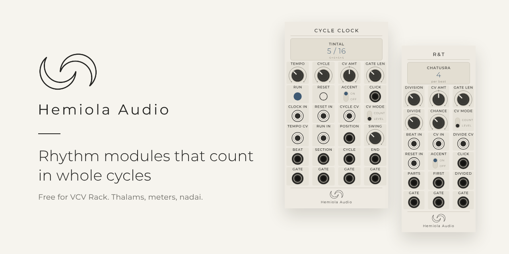
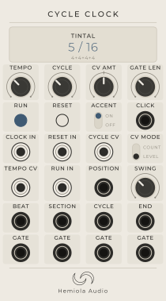
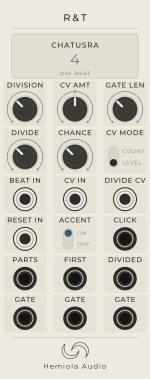

  

# Hemiola Audio for VCV Rack

Free modules for [VCV Rack](https://vcvrack.com) that count time in whole cycles: Indian thalams, ordinary bars, and the splits and patterns that grow out of them.

Most clocks tick. These know where they are. Cycle Clock knows it is on beat 11 of 16, and R&T can cut every beat into five, seven or nine equal parts, the way a Carnatic musician counts nadai.

**Version 2.0.0** · Free and open source · GPL-3.0-or-later

[Download](https://github.com/hemiolaaudio/HemiolaAudio/releases/latest) · [Manual](MANUAL.md) · [Hear it in a patch](#hear-it-in-a-patch) · [The story](docs/about.md) · [Say hello](#questions-ideas-and-corrections)

---

## The modules

<table>
<tr>
<td width="50%" valign="top">

### Cycle Clock · 14 HP

A clock that counts a whole rhythm cycle and tells you where you are in it.

- **55 cycles:** 13 ordinary meters, 7 Hindustani thalams and all 35 Carnatic thalams
- **Pulses everywhere:** beat, section start, cycle start and cycle end, each as a trigger and as a gate
- **Position voltage** that rises across the cycle, for anything that should follow the bar
- **Accented click** on beat one, so you can hear the count
- **Swing, tempo CV and a run input** on the built-in clock, or follow your own clock
- **Change the cycle by CV**, by level or by count, and it waits for the end of the lap

[Read the Cycle Clock manual](docs/CycleClock.md)

</td>
<td width="50%" valign="top">

### R&T (Rhythm & Thalam) · 10 HP

Splits every incoming beat into equal parts, and then divides those parts.

- **1 to 9 parts per beat:** tisra (3), chatusra (4), khanda (5), misra (7), sankirna (9), plus the plain even splits
- **DIVIDE 1 to 64**, with its own outputs, so a fast nadai becomes slow enough to follow
- **Chance knob** drops parts at random, so a pattern breathes
- **Reset input** to keep the count lined up with the bar
- **Division and divide by CV**, by level or by count
- **Accented click**, triggers and gates on every output

[Read the R&T manual](docs/RhythmTalam.md)

</td>
</tr>
</table>

They work alone, and they work as a pair. Patch a Cycle Clock BEAT output into R&T BEAT IN, and the CYCLE trigger into R&T RESET IN. The manual shows how, with recipes.

## Install

**From a release (Mac with Apple silicon).**
1. Open the [latest release](https://github.com/hemiolaaudio/HemiolaAudio/releases/latest) and download the file that ends in `.vcvplugin`.
2. Put it in the `plugins-mac-arm64` folder inside `Documents/Rack2`.
3. Start Rack. It unpacks the plugin on launch. Right-click an empty part of the rack, then search "Hemiola".

Windows, Intel Mac and Linux builds come through the VCV Library (below), which compiles the plugin for every system. You can also [build it yourself](#build-from-source).

**From the VCV Library.** Hemiola Audio has been submitted to the [VCV Library](https://library.vcvrack.com). Once it is listed, add it to your account on the Library page and Rack installs it for you.

In Rack, right-click either module and choose **User manual** to open its page here.

## Hear it in a patch

Two small patches are in the [`patches`](patches) folder. Download one, then open it in Rack with **File, Open**.

| Patch | What you hear |
| --- | --- |
| [Minimal Techno, 131 BPM](patches/Hemiola%20Minimal%20Techno%20131%20BPM.vcv) | Cycle Clock holds the bar and R&T splits the beat. |
| [Rainy Sunday Ambient](patches/Hemiola%20Rainy%20Sunday%20Ambient.vcv) | Slow and open, with Cycle Clock and R&T keeping time underneath. |

## Why "Hemiola"

A hemiola is the moment three beats lean against two. Cycles and divisions that do not fit neatly into each other are what this pack is for. The thalam names in the modules follow South Indian usage, and each preset has a source in the manual.

## Questions, ideas and corrections

- Something wrong or missing? [Open an issue](https://github.com/hemiolaaudio/HemiolaAudio/issues/new/choose). There are short forms for a bug, an idea, and a correction to a thalam.
- Prefer email? hemiolaaudio@gmail.com
- Thalam presets are checked against published sources and are open for review. If you teach or play and see a mistake, please say so.

## About

Hemiola Audio is one person, new to building modules, who makes music in VCV Rack most days. The code is written with an AI assistant. Every decision about what a module does, how it looks and whether it feels right is made by a person, in a patch, by ear. The timing rules are covered by automatic tests. More modules are planned. Read [the full story](docs/about.md).

## Build from source

You need the [Rack SDK](https://vcvrack.com/manual/Building) for Rack 2 and a C++ compiler.

    export RACK_DIR=/path/to/Rack-SDK
    make install

On a Mac you can double-click `Build and Install.command` instead. The timing logic lives in `core/` and does not depend on Rack. `tests/run_tests.sh` checks it on its own. See [CONTRIBUTING.md](CONTRIBUTING.md) if you would like to help.

## Licence and credits

Free software under the GNU General Public License, version 3 or later. Panel lettering is Montserrat, used under the SIL Open Font Licence 1.1 (`res/fonts/OFL.txt`). The Hemiola Audio name and logo belong to Hemiola Audio.

Hemiola Audio is not affiliated with VCV.
